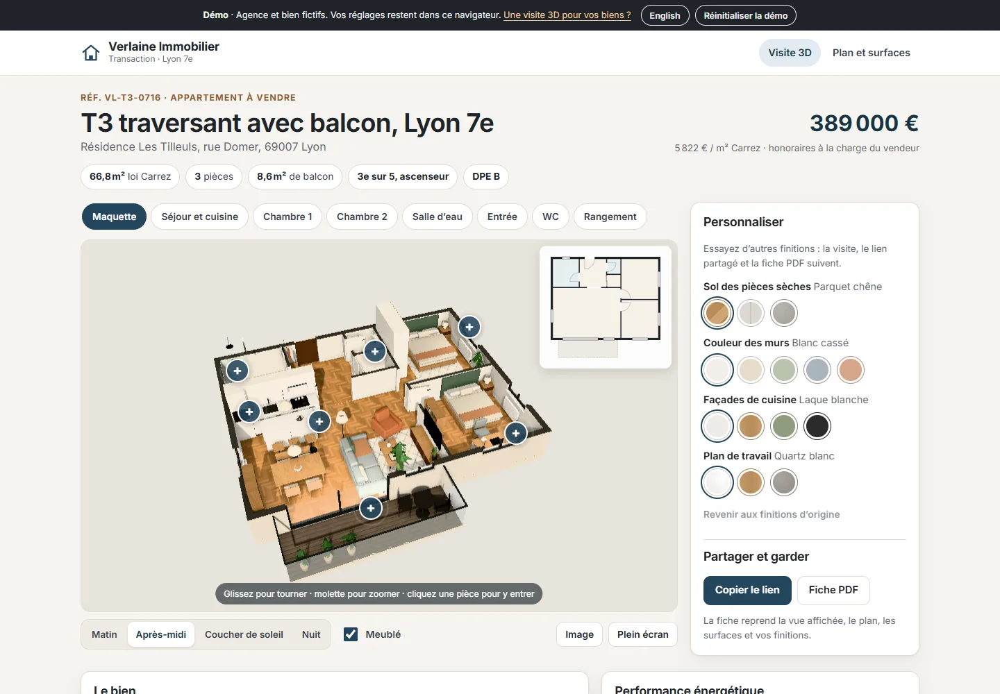
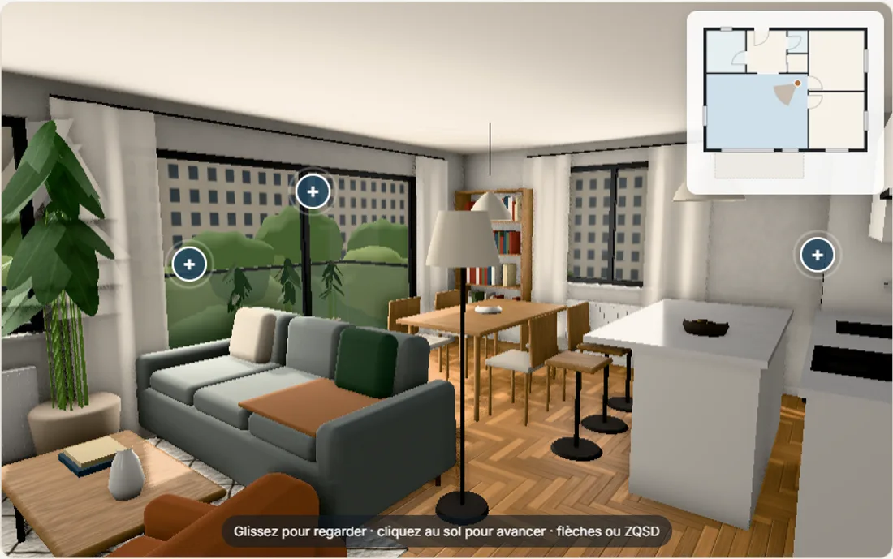
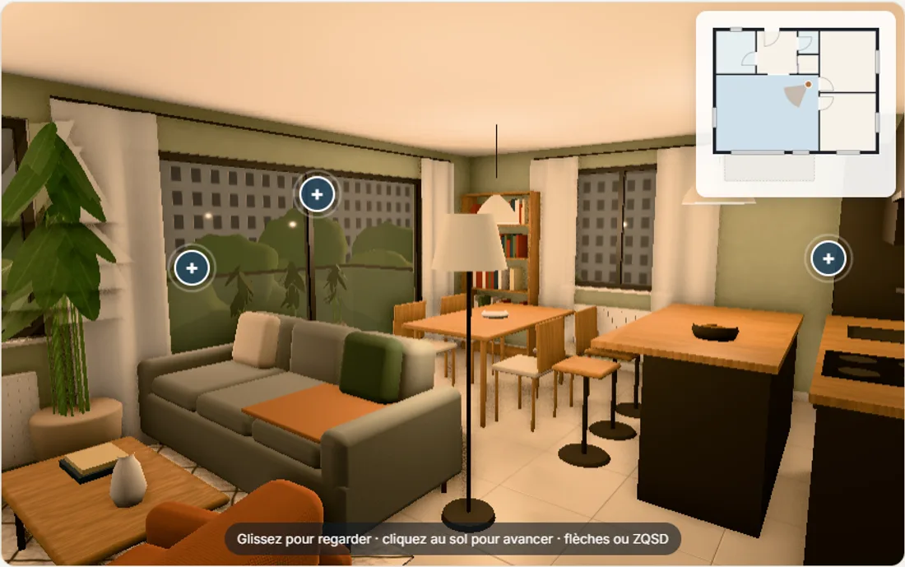
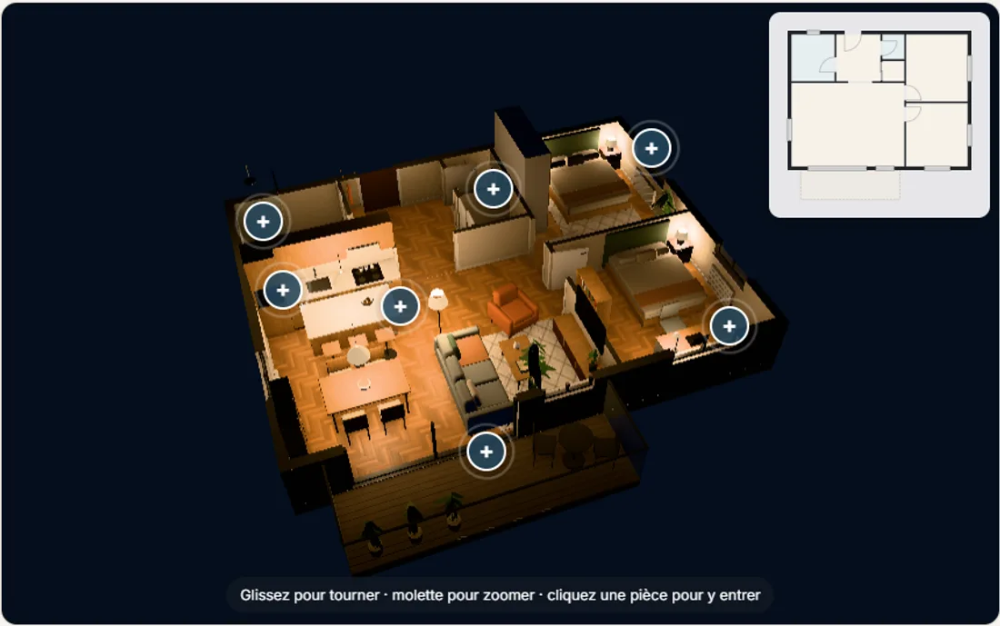
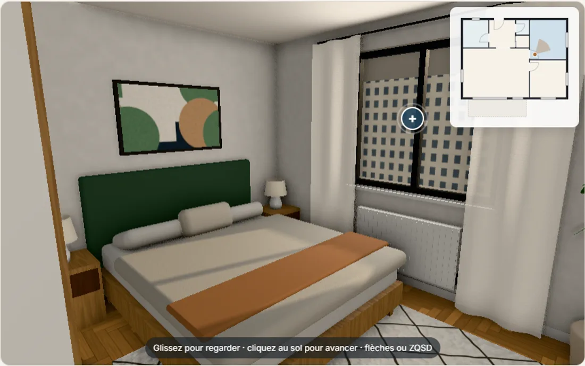
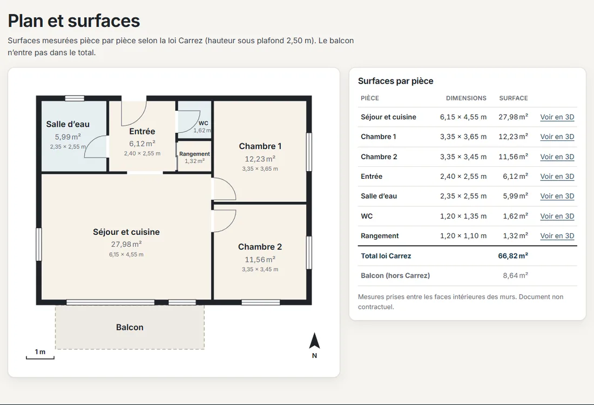
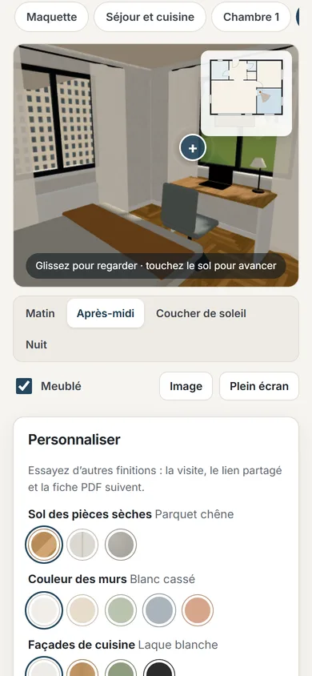
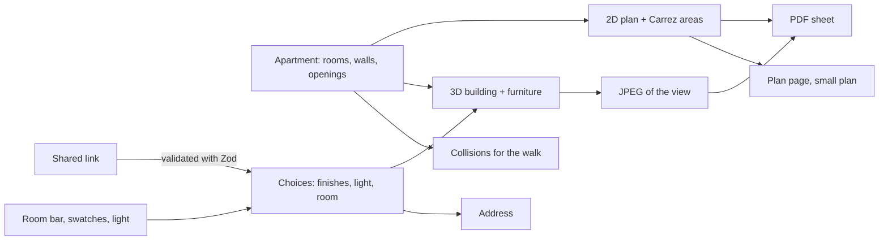

# Verlaine Immobilier · 3D apartment tour (demo)

[](https://github.com/Barkatzineddine/demo-visite-3d/actions/workflows/ci.yml)
[](https://barkatzineddine.github.io/demo-visite-3d/)

[](LICENSE)

A listing page for a fictional estate agency in Lyon, built around a **3D tour** of the flat for sale: a furnished two-bedroom apartment of 66.8 m² (Carrez law) with a balcony. Buyers fly over a **dollhouse** with the walls cut away, step into any room, **walk around** in first person, open **points of interest**, and try **other floors, wall colours and kitchen finishes** under **morning, afternoon, sunset or night** light, with or without the furniture. A **floor plan** lists every room's size and area, a **link** reopens the exact visit, and a two-page **PDF sheet** keeps the view, the facts, the finishes and the plan. French interface with an English switch, installable, works offline.

**Live: <https://barkatzineddine.github.io/demo-visite-3d/>** The agency, the flat and its price are fictional.



## Try it in two minutes

1. **Move the mouse** (or tap **Start the 3D tour** on a phone): the dollhouse appears. Drag to turn it, scroll to zoom.
2. **Click a room**, on the model, in the room bar or on the small plan: the camera flies in. Drag to look around, click the floor to walk there, or use the arrow keys / WASD. The small plan shows where you stand and which way you look.
3. Open a **+** marker: the walk-in shower, the 3.20 m sliding door, the main bedroom's area.
4. Under **Customise**, switch the floor to **polished concrete**, the walls to **sage green**, the kitchen to **matt black with an oak worktop**, then the light to **Sunset** and **Night**: lamps come on, the windows across the street light up.
5. **Copy the link** and open it elsewhere: same room, same finishes, same light. Download the **PDF sheet** ([sample](docs/exemple-fiche.pdf)), or open **Floor plan** for the Carrez table.

| Living room, afternoon | Other finishes at sunset |
| --- | --- |
|  |  |

| Dollhouse at night | Main bedroom, morning |
| --- | --- |
|  |  |

| Floor plan and Carrez areas | On a phone |
| --- | --- |
|  |  |

## Features

**The tour**
- **Dollhouse**: walls, doors and tiling cut at 1.15 m, ceilings and curtains hidden so every room reads from above; orbit with limits; the backdrop follows the time of day.
- **Room by room**: a room bar, a click on the model's floor or on the small plan flies the camera into the room (reduced motion: no flight).
- **First-person walk**: drag to look; arrow keys, WASD or ZQSD; click or tap the floor to walk there. Walls stop you and doors let you through; you can walk out onto the balcony.
- **Points of interest** pinned in 3D, with text that quotes the plan's areas.
- **Small plan** with the room you are in and a cone for where you look; it is also a way to move.
- **Picture** of the current view (JPEG) and **full screen**.

**Customise and share**
- Floor of the dry rooms (oak herringbone parquet, 60 × 60 porcelain tiles, polished concrete), five wall colours, four kitchen fronts, three worktops, furnished or empty, four lighting moods.
- Every choice goes to the address: a **link** reopens the same visit; a link that was cut or altered is checked, its invalid parts replaced by the originals, and the visitor is told.
- **PDF sheet** made in the browser: the view on screen, the listing's facts, the finishes picked, the link, then the floor plan drawn in vectors with each room's size and area and the Carrez total.

**The listing**
- Price and price per m², key facts, description, energy label (DPE) and greenhouse gas class with the estimated energy costs, the agent's contacts, and a **floor plan page** with the Carrez table (balcony counted apart).

## How it was made, and how it compares

Everything in the model is **generated in code**: no 3D files, photos or texture packs are downloaded from anywhere.

- **Geometry** comes from one description of the flat (`src/domain/apartment.ts`): rooms, walls with their windows and doors, the balcony. Walls are cut around the openings, doors are hung on the right side, skirting boards stop at the door frames, and the same data draws the 2D plan, computes the areas and stops the walker at the walls. The furniture (sofas, beds, kitchen, plants, lamps, bathroom) is modelled from boxes, rounded boxes, lathes and planes, and merged per material into a few dozen draw calls.
- **Materials** are PBR (colour, normal and roughness maps) from textures generated by [`scripts/textures.ts`](scripts/textures.ts): herringbone oak, terrazzo, zellige, porcelain, concrete, plaster, linen, a Berber rug, decking, the facades across the street, and two abstract prints. About 900 kB of WebP in all.
- **Light**: a physical sky that is also the scene's environment (reflections and bounce light), a sun at the right height and bearing for each mood, soft shadows that only enter through the openings, area lights in the windows, lamps that come on at dusk, screen-space ambient occlusion, a real mirror in the shower room, and lit windows across the street at night.

**Compared with commercial tours.** Products such as Matterport or the tours made with 360° cameras are built from **photographs** of a real flat: they are photo-real by nature, but each finish is what was there on the day. This demo is the other family, the **computer-generated** tours used to sell off-plan homes or to show renovation options: it is clearly CG (simplified furniture, plants made of leaf cards, no global illumination), closer to a good real-time architectural visualisation than to a photo. What it does that photo tours cannot is change floors, colours, kitchen finishes, furniture and light live, and keep the plan, the areas and the sheet in step with the model. Making it photo-real would take baked lighting or path tracing and modelled or scanned furniture, at a cost of tens of megabytes; this one loads in about 1 MB.

## Engineering

**Stack:** React 19, TypeScript 6 in strict mode, Vite 8, three.js (used directly, without a React wrapper), Zustand, Zod (`zod/mini`). No UI kit, no PDF library (a small PDF writer that embeds JPEG and draws the plan), no router library. Every dependency is pinned to an exact version.



- **The engine is plain three.js, apart from React** (`src/engine/`): it builds the scene, applies choices without recompiling a shader (materials are updated in place, the number of lights never changes), moves the camera, and reports what the interface needs (the room, the visitor's position, the hotspots on screen). It draws **only when something changes**, and the sun's shadows are computed once per time of day, so an idle tour costs nothing.
- **Light first screen, heavy 3D later.** The page is pre-rendered at build time and shows before any JavaScript, with a still of the dollhouse rendered by the engine itself as its largest image. three.js and the textures (about 1 MB) load at the visitor's first move on a desktop, and on request on a phone. Phones, and computers without a usable GPU, get a lighter renderer (no ambient occlusion, area lights or mirror, a lower resolution); the shaders of the rooms are compiled while the dollhouse is on screen, so the first step into a room does not stall.
- **One source of truth.** The plan page, the small plan, the PDF and the walk all read the same apartment description as the 3D model; the areas are computed, not typed.

```
src/
  domain/   the apartment (rooms, walls, openings, areas, collisions), the 2D plan, the agency and finishes, choice schemas
  engine/   Engine (scene, cameras, input, frames), structure, furniture, materials, lighting, geometry helpers
  state/    choices kept in the address, the capture hook for the PDF
  pdf/      writer.ts (PDF 1.4 with JPEG) and sheet.ts (the two-page sheet)
  shared/   router, i18n, service worker, download, feedback and dialog
  ui/       viewer, floor plan (SVG), finishes panel
  pages/    Tour, PlanPage
scripts/    textures.ts, the texture generator (npm run textures)
build/      Vite plugins (CSP with the boot script's hash, service worker, app preload) and the pre-render step
tests/      unit/ (Vitest) and e2e/ (Playwright)
```

## Quality gates

Every push runs the [CI workflow](.github/workflows/ci.yml); the site is deployed to GitHub Pages only when everything passes.

| Gate | What it checks |
| --- | --- |
| Lint and types | `typescript-eslint` strict, React hooks rules, ban on `innerHTML` and friends; `tsc` strict |
| Unit tests | 29 Vitest tests: areas and the Carrez total, openings inside their walls, rooms tiling the flat, walking through doors and out to the balcony but not through walls, the plan (no wall over a window, door swings into their rooms), share link round trip and tampering, choices in the address, the PDF writer's JPEG embedding, the two-page sheet in French and English, translations, CSP hashing, service worker timeout. Coverage thresholds on the logic (98 % of lines today) |
| Browser tests | 24 Playwright scenarios on a desktop and a mobile profile, with WebGL on SwiftShader: flying into rooms and back, the small plan, walking by keyboard and by click or tap, points of interest, finishes, light and furniture following into the address and back after a reload, copying the link, PDF and picture downloads (a real render), 3D only on request on phones, the page without WebGL, the plan page, English, the pre-rendered first screen, axe scans (WCAG 2.2 AA) including a keyboard-only tour, CSP and Trusted Types, altered links, no request to another site, offline mode. Any console error fails the test |
| Lighthouse | Lighthouse CI budgets: performance ≥ 95, accessibility 100, best practices 100, SEO ≥ 90 |
| Supply chain | `npm audit`, `npm ci --ignore-scripts`, Actions pinned by commit SHA, Dependabot with a 7-day cooldown |

Lighthouse on the production build (24 October 2026): tour page **99 / 100 / 100 / 100** on mobile and **100 / 100 / 100 / 100** on desktop; plan page 98 / 100 / 100 / 100 on mobile, 100 on desktop. Lighthouse measures the page as it loads, before the 3D, which waits for the visitor.

## Security and privacy

- **Strict Content Security Policy with Trusted Types**: scripts, styles, fonts and images from the site only, plus the inline boot script allowed by its hash; the browser refuses any HTML string injection, and a browser test proves it.
- **No tracker, cookie, CDN or third-party request**, which a browser test checks over a whole visit; the textures are generated and served by the site.
- **Shared links are untrusted**: decoded field by field against the schema; anything unknown falls back to the original finishes, and the visitor is told.
- **Documents stay on the device**: the PDF and the picture are made in the browser.

**Limits, stated plainly:** this is a front-end demo with a fictional listing. In production the listing would come from the agency's software, the contact buttons would reach a real agent, and the CSP would be sent as an HTTP header.

## Run it locally

Requires Node.js 24 and Chrome (the build pre-renders the first screen with it).

```bash
npm ci
npm run dev
```

```bash
npm test               # unit tests
npm run test:e2e       # builds, serves and runs the browser tests
npm run build          # production build in dist/
npm run textures       # regenerates public/textures (needs sharp, a dev dependency)
```

## Credits and license

- Code: [MIT](LICENSE), © 2026 Mohamed Zineddine Barkat.
- Textures, furniture and the dollhouse still: generated by this repository's code (no third-party assets).
- Font: Inter (SIL Open Font License, self-hosted). 3D: [three.js](https://threejs.org/), MIT, including its Sky, Reflector, OrbitControls and GTAO add-ons.
